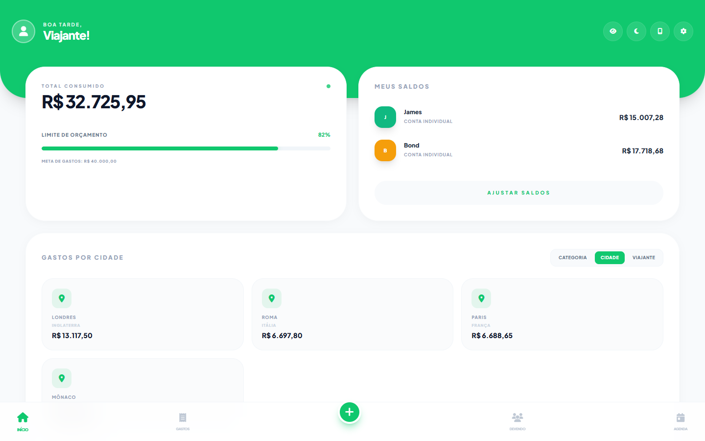
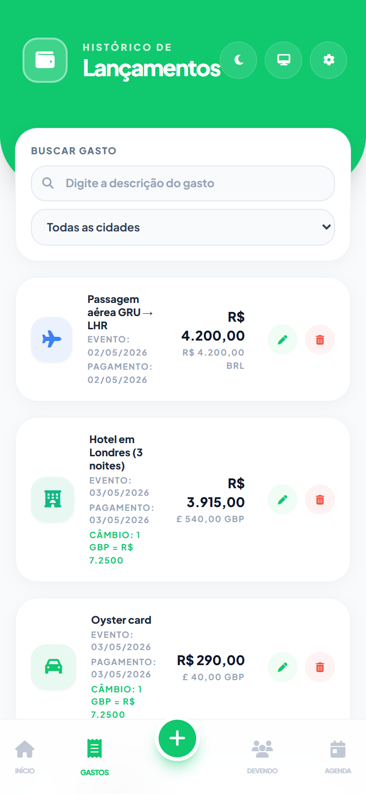

# SmartTrip (ViagemSmart)

Controle de gastos para viagens em grupo: registre cada despesa na moeda local, veja tudo convertido para reais com a cotação do dia do pagamento e saiba exatamente quem deve quanto para quem no fim da viagem.

<p align="center">
  
  
  
</p>

> As capturas mostram a viagem de demonstração (James e Bond), com dados totalmente fictícios.

## Funcionalidades

- **Visão geral da viagem** com total gasto, barra de progresso do orçamento e o saldo de cada viajante.
- **Gastos por cidade, categoria ou viajante**, alternando o agrupamento com um clique.
- **Multimoeda com cotação histórica.** Cada gasto guarda o valor original (EUR, USD, GBP, ARS…) e o valor convertido para BRL usando a cotação da **data do pagamento**, obtida na [AwesomeAPI](https://docs.awesomeapi.com.br/api-de-moedas).
- **Divisão de despesas.** Informe quem pagou e entre quem o gasto é dividido. A aba **Devendo** calcula quem deve para quem, com o resumo líquido entre as pessoas e a opção de marcar cada pendência como paga.
- **Agenda.** Calendário mensal com os gastos de cada dia, inclusive horário de início e fim de atividades (passeios, museus, trens).
- **Entrada inteligente com IA (opcional).** Escreva algo como *"Aluguel do carro 200 EUR dividido"* e o Gemini preenche descrição, valor, moeda e categoria.
- **Importação em lote via CSV**, com modelo para download.
- **Configurações:** meta de gastos, viajantes, destinos e categorias personalizáveis.
- Tema claro/escuro, modo para ocultar valores e layout **mobile** ou **desktop**.

<p align="center">
  
</p>

<p align="center">
  
  
</p>

## Stack

- React 19 + TypeScript + Vite
- Tailwind (via CDN) + Font Awesome
- [`@google/genai`](https://www.npmjs.com/package/@google/genai) para a entrada inteligente (modelo `gemini-3-flash-preview`)
- Persistência num arquivo JSON local (`data/tripState.local.json`), lido e gravado por um pequeno middleware dentro do `vite.config.ts`

## Rodando localmente

**Pré-requisito:** Node.js 20+

```bash
npm install
npm run dev          # http://localhost:3000
```

### Variáveis de ambiente

| Variável | Obrigatória | Descrição |
|---|---|---|
| `GEMINI_API_KEY` | Não | Chave do [Google AI Studio](https://aistudio.google.com/apikey). Copie o `.env.example` para `.env.local` (ignorado pelo git) e coloque a sua chave. Enquanto o valor for o placeholder, a chave é tratada como ausente. Sem a chave, o app funciona normalmente e só a entrada inteligente fica desativada. |

> **Atenção:** o Vite injeta `GEMINI_API_KEY` no JavaScript do navegador (`vite.config.ts`). Isso serve para uso local, mas **não publique um build com uma chave real**, porque qualquer pessoa conseguiria lê-la. Para deploy público, mova a chamada ao Gemini para um backend.

## Como os dados são salvos

O estado da viagem (viajantes, cidades, categorias, gastos e orçamento) fica em dois arquivos:

| Arquivo | Versionado? | Papel |
|---|---|---|
| `data/tripState.local.json` | Não (gitignored) | **Seus dados.** É lido primeiro e é o único arquivo em que o app grava |
| `data/tripState.json` | Sim | Viagem de demonstração (James e Bond). Só é lida enquanto o arquivo local não existe, e nunca é alterada |

Num clone novo, o app abre com a demonstração. Ao salvar o primeiro gasto, o `tripState.local.json` é criado e passa a ser a fonte dos dados.

Em `npm run dev`, o middleware do Vite expõe:

| Rota | Função |
|---|---|
| `GET /api/trip-state` | Lê o estado salvo |
| `PUT /api/trip-state` | Grava o estado atual no arquivo |
| `GET /api/exchange-rate` | Busca a cotação histórica para BRL (proxy da AwesomeAPI) |

Como essas rotas existem só no servidor de desenvolvimento, `npm run build` gera um site estático que usa o estado embutido no build. O [`SUPABASE_SETUP.md`](SUPABASE_SETUP.md) é uma **proposta, ainda não implementada**, de como trocar o arquivo local por um banco no Supabase.

### Segurança

O SmartTrip foi feito para rodar localmente. O servidor de desenvolvimento escuta só em `localhost`, e a API recusa pedidos de outros sites (`Origin`) ou com `Host` diferente de localhost. As gravações exigem `Content-Type: application/json`, têm limite de tamanho e passam por uma validação do formato. Não exponha o servidor na rede (nada de `--host 0.0.0.0` ou túneis).

## Estrutura

```
App.tsx                 navegação por abas e estado global da viagem
components/
  Dashboard.tsx         visão geral, saldos e gastos agrupados
  ExpenseForm.tsx       novo gasto: manual, IA Smart Input ou CSV
  Debts.tsx             quem deve para quem
  Calendar.tsx          agenda mensal de gastos
  PersonalSummary.tsx   resumo por viajante
  Settings.tsx          meta, viajantes, destinos e categorias
services/
  geminiService.ts      entrada inteligente e insights via Gemini
  exchangeRateService.ts cotação histórica (AwesomeAPI)
utils/                  formatação de moeda e datas
data/tripState.json     viagem de demonstração (versionada)
data/tripState.local.json  seus dados (gitignored, criado ao salvar)
```

## Licença

[MIT](LICENSE)
